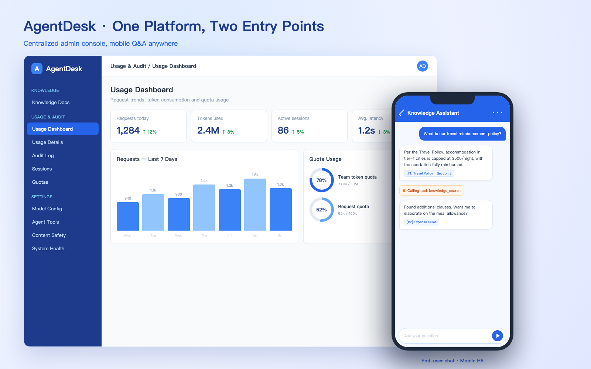
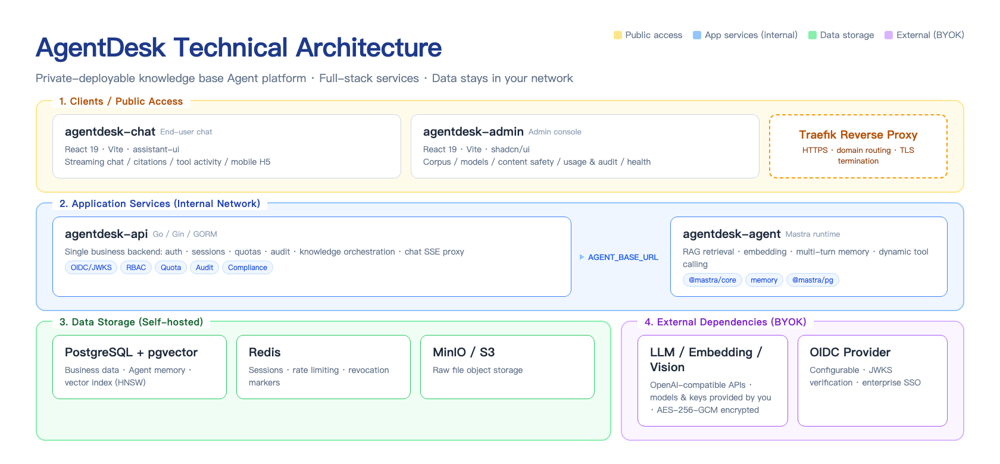
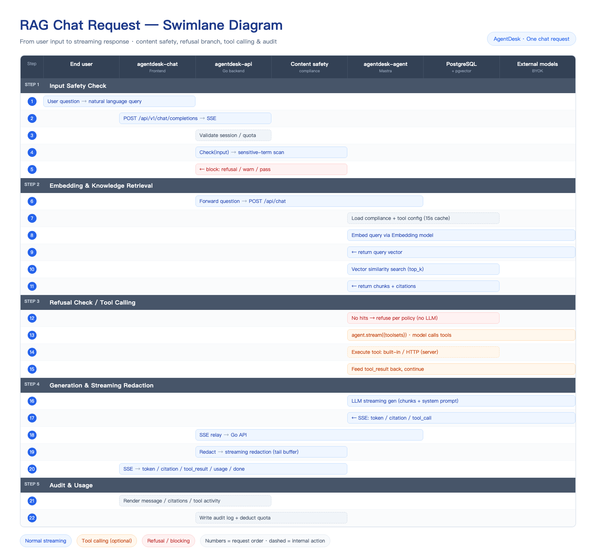

# AgentDesk · Private-Deployable Knowledge Base Agent Platform

**English** | [简体中文](./README.zh-CN.md)

> An end-to-end reference implementation of a **Mastra-based**, privately deployable RAG knowledge base + Agent runtime: upload documents → chunk & embed → streaming Q&A → citation tracing → audit & quota, all out of the box.

## Why AgentDesk

- **Built on Mastra**: The Agent runtime is built on [Mastra](https://mastra.ai) (`@mastra/core` + `@mastra/memory` + `@mastra/pg`). Multi-turn memory, vector retrieval, and dynamic tool calling all stand on a mature framework, not hand-written loops.
- **Not an SDK, but a complete service suite**: business backend, end-user chat, admin console, Agent runtime, and deployment orchestration are all in place.
- **Answers you can trace**: every answer carries original source citations from the knowledge base, with automatic fallback on low confidence — purpose-built to fight AI hallucinations.
- **Enterprise-ready out of the box**: OIDC/JWKS, RBAC, sessions, quotas, and audit logs are first-class citizens.
- **Data never leaves your network**: PostgreSQL + pgvector, Redis, and object storage can all be deployed privately; the Agent runtime is exposed only on the internal network.
- **Bring your own model (BYOK)**: no vendor lock-in. Chat / embedding / vision interfaces can be switched freely in the admin console; keys are stored encrypted and take effect hot.
- **Built-in content safety**: tiered sensitive-word blocking, automatic output redaction, and automatic refusal when there is no retrieval basis — all configurable in the admin console and effective immediately.
- **Agents can call tools autonomously**: built-in current time and knowledge search, plus any HTTP endpoint registered as a tool; the model calls them on demand and the whole process is visible in the conversation.
- **Unified blue-themed UI**: the end-user chat and admin console share a clean blue visual identity based on shadcn/ui semantic color variables, responsive across desktop and mobile.

AgentDesk is positioned as a **general-purpose knowledge base Agent platform, not tied to any single industry**. E-commerce content appearing in the repository is fictional sample data; the code itself contains no product, order, or transaction logic.

## Use Cases

| Scenario | Typical Use | Capabilities Used |
|----------|-------------|-------------------|
| Enterprise knowledge assistant | Ingest policies, product manuals, and SOPs; employees query in natural language with source citations | Multi-store retrieval, citation tracing, incremental updates |
| Customer support / pre-sales Q&A | Ingest FAQs, after-sales policies, and return rules; 24/7 auto-response, escalation on low confidence | Streaming chat, fallback responses, multi-turn memory |
| Channel / partner enablement | Ingest partner policies, tiered benefits, and training materials for partner self-service learning and Q&A | Role-based access, compliance blocking, Q&A audit |
| Compliant content generation | Pre-empt exaggeration and non-compliant phrasing via a compliance lexicon; unify outbound messaging | Sensitive-word blocking, response templates, version management |
| Document preview site | Online preview of technical proposals and delivery documents, with TOC and theme switching | Data-driven rendering, i18n, hash routing |

## System Components

| Application | Path | Stack | Responsibility |
|-------------|------|-------|----------------|
| Business backend | `apps/agentdesk-api` | Go + Gin + GORM | The single business backend: auth, sessions, quotas, knowledge base orchestration, chat SSE proxy, audit |
| End-user chat | `apps/agentdesk-chat` | React 19 + Vite + assistant-ui | Streaming chat, citation display, mobile H5 |
| Admin console | `apps/agentdesk-admin` | React 19 + Vite + shadcn/ui | Corpus upload, model config, quota & audit viewing, sensitive words & refusal policies |
| Agent runtime | `apps/agentdesk-agent` | Mastra + @mastra/pg | RAG retrieval, embedding, dynamic tool calling; internal-network HTTP service only |
| Deployment orchestration | `deploy/` | Docker Compose + Traefik | Local and production deployment templates |
| Document preview site | `packages/web` | Vite + Vanilla JS | Online preview of delivery documents (sample data) |

## UI & Theming



Both frontends use a unified blue theme based on shadcn/ui semantic color variables (`--primary`, `--ring`, `--sidebar-*`, etc.). Changing the theme only requires adjusting one place in the CSS variables to take effect globally.

| Interface | Entry | Notes |
|-----------|-------|-------|
| End-user chat | `apps/agentdesk-chat`, port `5173` | Blue brand icon and send button, streaming chat, citation popover, tool-call process display; responsive mobile H5 |
| Admin console | `apps/agentdesk-admin`, port `5174` | Blue sidebar highlight and charts, metric cards / trend charts / quota progress bars in the same color family; includes light and dark theme variables |

Theme colors are defined in each app's `src/index.css`:
- The admin console uses Tailwind v4 + `oklch` semantic colors (with a `.dark` mode); charts and metric cards follow the primary color via compatibility variables.
- The chat app uses CSS custom properties (e.g. `--accent: #2563eb`); brand gradient, user bubbles, send button, and input focus border are all blue.

## Repository Structure

```text
agentdesk/
├── apps/
│   ├── agentdesk-api/       # Go business backend
│   ├── agentdesk-chat/      # End-user chat H5
│   ├── agentdesk-admin/     # Admin console
│   └── agentdesk-agent/     # Mastra Agent runtime
├── packages/
│   └── web/                 # Document preview site (Vite + Vanilla JS)
├── deploy/                  # Docker Compose / Traefik / K8s references
├── docs/                    # Design & implementation notes
├── design.md                # Design specification
├── DEPLOY.md                # Deployment guide
└── README.md
```

## Architecture

```text
agentdesk-chat / agentdesk-admin
        │
        ▼
   agentdesk-api  ←── the single Go business backend
        │
        ├── OIDC / JWKS (configurable provider)
        ├── PostgreSQL (business data + Agent memory + vectors)
        ├── Redis (sessions / rate limiting)
        ├── MinIO / S3 (raw files)
        └── agentdesk-agent (internal network only)
                 └── OpenAI-compatible LLM / Embedding / Vision
```



The swimlane below traces a complete RAG Q&A request — input safety check, vector retrieval, no-basis refusal, tool calling, streaming redaction, and audit — across the user, Chat UI, API, content safety, Agent, PostgreSQL, and external model lanes.



Design constraints:

- Do not expose the Agent runtime to the public internet; it is called only by the Go backend via `AGENT_BASE_URL`.
- No separate Billing service; entitlements and quotas are consolidated in the Go service's `modules/entitlement` and `modules/quota`.
- No physical foreign keys in the database; use logical `*_id` and application-layer constraints.
- The API is unified under `/api/v1/`; success returns `{success,data}`, errors follow RFC 7807.
- No hard-coded access passwords in the frontend; production auth uses configurable OIDC/JWKS.

## Quick Start

### 1. Docker Compose (recommended)

```bash
cd deploy
cp .env.example .env
cp agentdesk-api.env.example agentdesk-api.env
cp agentdesk-agent.env.example agentdesk-agent.env
# Adjust database, Redis, S3, OIDC, encryption key, etc. as needed
docker compose up -d --build
```

Database migration:

```bash
cd ../apps/agentdesk-api
cp .env.example .env
make migrate-up
```

After startup, visit:

- Chat: `http://localhost:5173`
- Admin console: `http://localhost:5174`
- Go API: `http://localhost:8080/health`

### 2. Local Development

```bash
# Document preview site
pnpm install
pnpm approve-builds esbuild
pnpm dev

# Frontend dev servers
pnpm dev:chat
pnpm dev:admin

# Go API
cd apps/agentdesk-api && make run
```

### 3. Document Preview Site (packages/web)

A pure static site using hash routing, so no server-side rewrite is needed:

```bash
pnpm build
# Output is in packages/web/dist/, deployable to any static server or CDN
pnpm preview
```

Supports five document types (requirements research, technology selection, quotation, integration checklist, clarification) with Chinese/English switching, dark/light themes, and PC/mobile responsiveness. Document data lives in `packages/web/src/data/` — replace it with your own content.

## Custom Models & API Keys (BYOK)

AgentDesk **is not tied to any model vendor**. Chat, embedding, and vision models are configured independently; any OpenAI-compatible interface works — OpenAI, DeepSeek, Qwen, Moonshot, or self-hosted vLLM / Ollama gateways. Model endpoints and API keys are provided by the user and never written into source code or Docker images.

### Where to configure

Log in to the admin console → "Model Configuration" (route `/settings/ai`). Config is stored in the `runtime_ai_settings` table; the Agent runtime reads from the database, with no hard-coded model endpoints or keys in environment variables.

### Three model types

| Model | Interface Requirement | Purpose |
|-------|-----------------------|---------|
| Chat model | OpenAI Chat Completions | Streaming Q&A, citation generation |
| Embedding model | OpenAI Embeddings | Document chunk embedding and retrieval |
| Vision model | OpenAI multimodal Chat Completions | Text extraction from image documents (OCR) |

Each type needs an endpoint (e.g. `https://api.example.com/v1`), a model ID, and an API key. The system is considered `configured` only when all three are complete, after which knowledge base and Q&A features become available. On the same page you can also adjust `retrieval_top_k` (number of retrieved chunks) and `snippet_max_chars` (citation snippet length).

### Key storage & security

- API keys are encrypted with **AES-256-GCM** and stored in `runtime_ai_settings.secrets_ciphertext`, never in source code, environment variables, or the frontend.
- Admin APIs return only `*_key_set` booleans, never plaintext keys; leaving an input empty means "keep the existing key".
- Encryption relies on the server environment variable `CONFIG_ENCRYPTION_KEY` (32 bytes, accepts 64-char hex / base64 / raw string):

  ```bash
  openssl rand -hex 32
  ```

  **The Go API and the Agent runtime must use the same value**, otherwise the Agent cannot decrypt. Changing this key invalidates stored keys and requires re-entry.
- Without `CONFIG_ENCRYPTION_KEY`, saving in the admin console fails immediately, preventing plaintext at rest.

After saving, the Agent side caches the config and it takes effect in **about 15 seconds, no restart required**. Switching providers or rotating a key only requires editing the corresponding field in the admin console and saving.

> Note: Embedding dimension is an ops-level setting controlled by `EMBEDDING_DIMENSION` (default 1536, pgvector HNSW limit 2000); changing it requires rebuilding the vector index.

Admin APIs: `GET /api/v1/admin/ai-settings` (read, no plaintext keys), `PUT /api/v1/admin/ai-settings` (update, admin permission required).

## Content Safety & Refusal Policies

Admin console → "Content Safety" (route `/settings/compliance`) provides two capabilities:

### Sensitive word configuration

- Terms support two levels: `warn` (warning) and `block` (forbidden), with a category and a compliance suggestion; matching is case-insensitive.
- **Input policy**: `off` no action / `warn` notify but continue / `block` intercept and refuse. On a `block` match the model is not called and a `compliance_blocked` event is returned directly.
- **Output policy**: `off` no action / `warn` notify / `redact` replace matched terms with a mask (default `***`). Output redaction runs during SSE streaming, with a small trailing buffer to catch terms spanning chunks.
- A built-in rule test panel lets you inspect matches and redaction results without affecting production data.

### Refusal policies

- Enable "auto-refuse when there is no retrieval basis": if vector retrieval returns nothing this turn, the Agent returns a custom refusal response without calling the chat model.
- Refusal and low-confidence prompts are editable in the admin console and take effect on the next request (15-second Agent cache).
- The system prompt also injects refusal constraints, forming a dual safeguard of "retrieval pre-check + prompt constraint".

Related APIs:

| Method | Path | Description |
|--------|------|-------------|
| GET / PUT | `/api/v1/admin/compliance/settings` | Read / update blocking & refusal policies |
| GET / POST | `/api/v1/admin/compliance/terms` | Sensitive term list / add |
| PUT / DELETE | `/api/v1/admin/compliance/terms/:id` | Edit / delete a sensitive term |
| POST | `/api/v1/admin/compliance/test` | Text detection & redaction preview |

## Agent Tool Extension

Once you register a tool under admin console → "Agent Tools" (route `/settings/tools`), the chat model will **decide autonomously when to call it**. Tool definitions live in the `agent_tools` table; the Agent runtime caches them for 15 seconds, so changes take effect without a restart.

### Built-in tools

| Tool | Purpose |
|------|---------|
| `current_time` | Return server ISO time, local time, and timezone for time-sensitive questions |
| `knowledge_search` | Run an extra vector search over the knowledge base, returning cited snippets; called when injected snippets are insufficient |

Built-in tools are enabled by default via migration; they cannot be deleted but can be disabled.

### HTTP tools

Register an internal API as a tool; the model calls it on demand. `config` is JSON:

```json
{
  "method": "POST",
  "url": "https://internal.example.com/api/order?q={{query}}",
  "headers": { "Authorization": "Bearer {{token}}" },
  "body": "{\"q\":\"{{query}}\"}",
  "response_path": "data.items",
  "timeout_ms": 8000,
  "max_output_chars": 4000
}
```

- `{{param}}` placeholders are replaced at call time with the arguments supplied by the model (in URL / headers / body).
- `input_schema` describes arguments with JSON Schema (`type` / `description` / `required`) — this is what the model sees and fills in.
- `response_path` extracts a field from the JSON response by dot path; output is char-limited to avoid bloating the context.
- Tool calls and results are streamed to the chat frontend as `tool_call` / `tool_result` / `tool_error` SSE events, and the UI shows the call process.

Security note: HTTP tools execute server-side, allow only `http/https` addresses, and have timeouts and output limits. Only connect **trusted internal endpoints** — never expose publicly reachable, write-capable, or credential-bearing addresses to end users.

Related APIs:

| Method | Path | Description |
|--------|------|-------------|
| GET | `/api/v1/admin/tools` | Tool list |
| GET | `/api/v1/admin/tools/:id` | Read a single tool |
| POST | `/api/v1/admin/tools` | Create a tool |
| PUT / DELETE | `/api/v1/admin/tools/:id` | Edit / delete a tool (built-ins cannot be deleted) |
| POST | `/api/v1/admin/tools/:id/test` | Run a tool once with sample arguments |

## Main APIs

| Method | Path | Description |
|--------|------|-------------|
| POST | `/api/v1/auth/app-code` | Server issues a one-time code |
| POST | `/api/v1/auth/exchange` | Exchange a one-time code for a session cookie |
| GET | `/api/v1/auth/me` | Current user |
| POST | `/api/v1/docs` | Upload corpus (async chunking & ingestion) |
| GET | `/api/v1/docs` | Document list & status |
| POST | `/api/v1/chat/completions` | SSE chat (token / citation / tool_call / tool_result / usage / done) |
| GET | `/api/v1/chat/threads` | Chat history |

Full contract: `apps/agentdesk-api/api/openapi.yaml`.

## Open Source Notes

- Brand, tenants, accounts, documents, and sample data are all unified to AgentDesk or fictional samples, corresponding to no real entity.
- Demo credentials are `CHANGE_ME` placeholders; internal domains, project IDs, preview tokens, server IPs, and deployment platform project IDs are removed or replaced with `example.com` / `REPLACE_ME`.
- No hard-coded access passwords in the frontend; production auth uses configurable OIDC/JWKS.
- Do not commit `.env` files, keys, database backups, or real business data.

## License

[MIT](./LICENSE)
