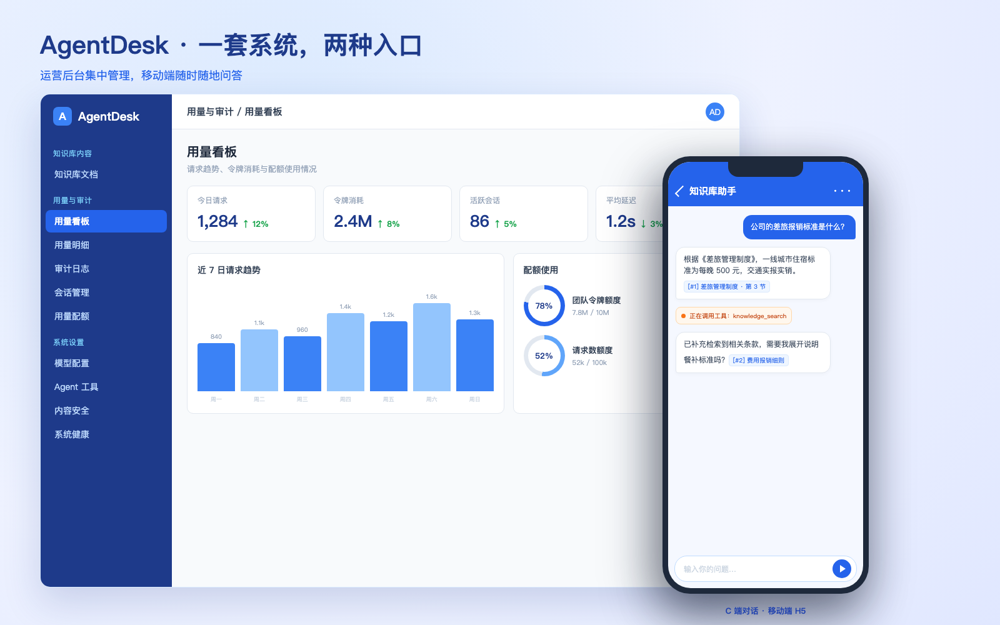
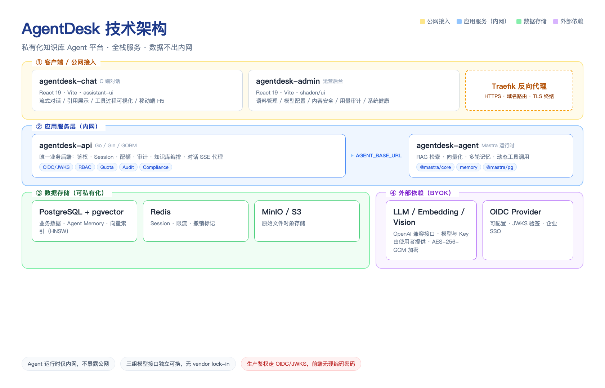
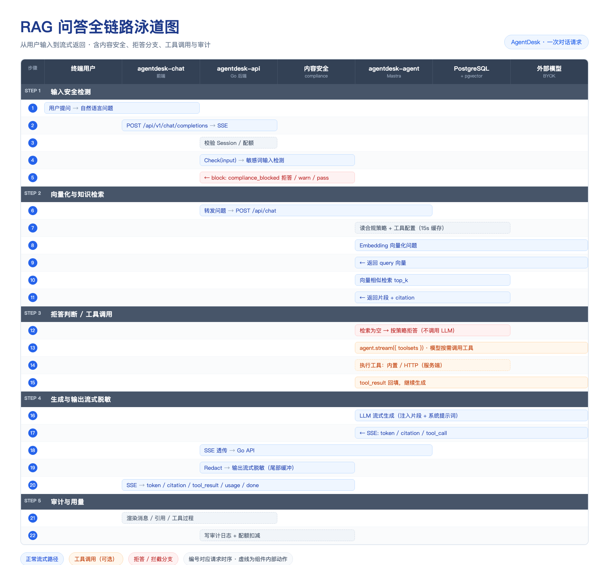

# AgentDesk · 私有化知识库 Agent 平台

[English](./README.md) | **简体中文**

> 一套**基于 [Mastra](https://mastra.ai) Agent 框架**、可私有化部署的 RAG 知识库 + Agent 运行时端到端参考实现：上传文档 → 分块向量化 → 流式问答 → 引用溯源 → 审计与配额，全链路开箱即用。

## 为什么是 AgentDesk

- **基于 Mastra 构建**：Agent 运行时采用 [Mastra](https://mastra.ai)（`@mastra/core` + `@mastra/memory` + `@mastra/pg`），多轮记忆、向量检索、动态工具调用都建立在成熟框架之上，而非手写裸循环。
- **不是 SDK，而是一整套服务**：业务后端、C 端对话、运营后台、Agent 运行时与部署编排全部就位。
- **答案可溯源**：每次回答附带知识库原文出处，低置信度自动兜底，专门对付 AI 幻觉。
- **企业能直接接**：OIDC/JWKS、RBAC、Session、配额、审计日志都是一等公民。
- **数据不出内网**：PostgreSQL + pgvector、Redis、对象存储均可私有化部署，Agent 运行时只对内网开放。
- **自带任意模型（BYOK）**：不绑定模型厂商，对话 / 向量 / 视觉三类接口可在后台自由切换，Key 加密存储、热生效。
- **内置内容安全**：敏感词分级拦截、输出自动脱敏、无检索依据时自动拒答，规则在后台配置且即时生效。
- **Agent 可自主调用工具**：内置当前时间、知识库检索，并可注册任意 HTTP 接口作为工具；模型按需调用，调用过程在对话中可见。
- **统一蓝色主题界面**：C 端对话与运营后台共用清爽的蓝色视觉，基于 shadcn/ui 语义色变量，响应式适配桌面与移动端。

AgentDesk 的定位是**通用知识库 Agent 平台，不绑定任何单一行业**。仓库中出现的电商内容均为虚构示例数据，代码本身不含商品、订单或交易逻辑。

## 适用场景

| 场景 | 典型用法 | 用到的能力 |
|------|----------|------------|
| 企业知识助手 | 规章制度、产品手册、SOP 入库，员工自然语言查询，答案带原文出处 | 多库检索、引用溯源、增量更新 |
| 客服 / 售前问答 | FAQ、售后政策、退换货规则入库，7×24 自动应答，低置信度转人工 | 流式对话、兜底话术、多轮记忆 |
| 渠道 / 代理赋能 | 招商政策、分级权益、培训资料入库，合作伙伴自助学习与问答 | 权限分级、合规拦截、问答审计 |
| 合规内容生成 | 合规词库前置拦截夸大宣传与违规话术，统一对外输出口径 | 敏感词拦截、话术模板、版本管理 |
| 文档预览站 | 技术方案、交付文档的在线预览，含目录与主题切换 | 数据驱动渲染、i18n、Hash 路由 |

## 系统构成

| 应用 | 路径 | 技术 | 职责 |
|------|------|------|------|
| 业务后端 | `apps/agentdesk-api` | Go + Gin + GORM | 唯一业务后端：鉴权、Session、额度、知识库编排、对话 SSE 代理、审计 |
| C 端对话 | `apps/agentdesk-chat` | React 19 + Vite + assistant-ui | 流式对话、引用展示、移动端 H5 |
| 运营后台 | `apps/agentdesk-admin` | React 19 + Vite + shadcn/ui | 语料上传、模型配置、配额与审计查看、敏感词与拒答策略 |
| Agent 运行时 | `apps/agentdesk-agent` | Mastra + @mastra/pg | RAG 检索、向量化、动态工具调用；仅内网 HTTP 服务 |
| 部署编排 | `deploy/` | Docker Compose + Traefik | 本地与生产部署模板 |
| 文档预览站 | `packages/web` | Vite + Vanilla JS | 交付文档在线预览（示例数据） |

## 界面与主题



两套前端界面均使用统一的蓝色主题，视觉基于 shadcn/ui 的语义色变量（`--primary`、`--ring`、`--sidebar-*` 等），改主题只需调整一处 CSS 变量即可全局生效。

| 界面 | 入口 | 说明 |
|------|------|------|
| C 端对话 | `apps/agentdesk-chat` 端口 `5173` | 蓝色品牌图标与发送按钮、流式对话、引用弹层、工具调用过程展示；移动端 H5 自适应 |
| 运营后台 | `apps/agentdesk-admin` 端口 `5174` | 蓝色侧边栏高亮与图表、指标卡/趋势图/配额进度条同色系；含浅色与深色两套主题变量 |

主题色定义位于各应用的 `src/index.css`：
- 运营后台使用 Tailwind v4 + `oklch` 语义色（含 `.dark` 深色模式）；图表与指标卡通过兼容变量跟随主色。
- 对话端使用 CSS 自定义属性（如 `--accent: #2563eb`），品牌渐变、用户气泡、发送按钮、输入框聚焦边框均为蓝色。

## 仓库结构

```text
agentdesk/
├── apps/
│   ├── agentdesk-api/       # Go 业务后端
│   ├── agentdesk-chat/      # C 端对话 H5
│   ├── agentdesk-admin/     # 运营管理后台
│   └── agentdesk-agent/     # Mastra Agent 运行时
├── packages/
│   └── web/                 # 文档预览站（Vite + Vanilla JS）
├── deploy/                  # Docker Compose / Traefik / K8s 参考
├── docs/                    # 方案与实现约束
├── design.md                # 设计规范
├── DEPLOY.md                # 部署指南
└── README.md
```

## 架构

```text
agentdesk-chat / agentdesk-admin
        │
        ▼
   agentdesk-api  ←── 唯一 Go 业务后端
        │
        ├── OIDC / JWKS（可配置 Provider）
        ├── PostgreSQL（业务数据 + Agent Memory + 向量）
        ├── Redis（Session / 限流）
        ├── MinIO / S3（原始文件）
        └── agentdesk-agent（仅内网）
                 └── OpenAI 兼容 LLM / Embedding / Vision
```



下图沿用户、对话端、API、内容安全、Agent、PostgreSQL、外部模型七条泳道，追踪一次完整 RAG 问答请求——输入安全检测、向量检索、无依据拒答、工具调用、流式脱敏与审计。



设计约束：

- 不暴露 Agent 运行时到公网，只由 Go 后端通过 `AGENT_BASE_URL` 调用。
- 无独立 Billing 服务；权益与配额收敛在 Go 服务的 `modules/entitlement` 与 `modules/quota`。
- 数据库无物理外键，使用逻辑 `*_id` 与应用层约束。
- API 统一 `/api/v1/`，成功返回 `{success,data}`，错误遵循 RFC 7807。
- 前端不存在硬编码访问密码；生产鉴权走可配置的 OIDC/JWKS。

## 快速开始

### 1. Docker Compose（推荐）

```bash
cd deploy
cp .env.example .env
cp agentdesk-api.env.example agentdesk-api.env
cp agentdesk-agent.env.example agentdesk-agent.env
# 按需修改数据库、Redis、S3、OIDC、加密密钥等配置
docker compose up -d --build
```

数据库迁移：

```bash
cd ../apps/agentdesk-api
cp .env.example .env
make migrate-up
```

启动后访问：

- 对话端：`http://localhost:5173`
- 运营后台：`http://localhost:5174`
- Go API：`http://localhost:8080/health`

### 2. 本地开发

```bash
# 文档预览站
pnpm install
pnpm approve-builds esbuild
pnpm dev

# 前端联调
pnpm dev:chat
pnpm dev:admin

# Go API
cd apps/agentdesk-api && make run
```

### 3. 文档预览站（packages/web）

纯静态站点，使用 Hash 路由，无需服务端重写：

```bash
pnpm build
# 产物在 packages/web/dist/，可部署到任意静态服务器或 CDN
pnpm preview
```

支持五类文档（需求调研、技术选型、报价单、对接清单、问题澄清）的中英文切换、深色/浅色主题、PC/移动端自适应。文档数据集中在 `packages/web/src/data/`，替换为自有内容即可。

## 自定义模型与 API Key（BYOK）

AgentDesk **不绑定任何模型厂商**。对话、向量、视觉三类模型各自独立配置，只要接口兼容 OpenAI 规范即可接入——可以是 OpenAI、DeepSeek、通义、Moonshot 等云服务，也可以是自建的 vLLM / Ollama 网关。模型地址和 API Key 由使用者自行提供，不写入源码或 Docker 镜像。

### 在哪里配置

登录运营后台 →「模型配置」（路由 `/settings/ai`）。配置存入数据库 `runtime_ai_settings`，Agent 运行时从数据库读取，不依赖环境变量写死模型地址或 Key。

### 三类模型

| 模型 | 接口要求 | 用途 |
|------|----------|------|
| 对话模型 | OpenAI Chat Completions | 流式问答、引用生成 |
| 向量模型 | OpenAI Embeddings | 文档分块向量化与检索 |
| 视觉模型 | OpenAI 多模态 Chat Completions | 图片文档的文字提取（OCR） |

每类需填写接口地址（如 `https://api.example.com/v1`）、模型 ID 与 API Key。三组全部配置完整后系统才判定为 `configured`，知识库与问答功能才可用。同页还可调整召回条数 `retrieval_top_k` 与引用片段字数 `snippet_max_chars`。

### Key 的存储与安全

- API Key 用 **AES-256-GCM** 加密后存入 `runtime_ai_settings.secrets_ciphertext`，不写入源码、环境变量或前端。
- 后台接口只返回 `*_key_set` 布尔标记，不回传明文；输入框留空表示不修改已有 Key。
- 加解密依赖服务端环境变量 `CONFIG_ENCRYPTION_KEY`（32 字节，支持 64 位 hex / base64 / 原始字符串）：

  ```bash
  openssl rand -hex 32
  ```

  **Go API 与 Agent 运行时必须配置同一个值**，否则 Agent 无法解密。更换该密钥会使已存的 Key 失效，需重新录入。
- 未配置 `CONFIG_ENCRYPTION_KEY` 时，后台保存会直接报错，避免明文落库。

配置保存后由 Agent 侧缓存，**约 15 秒自动生效，无需重启**。更换服务商或轮换 Key 只需在后台修改对应字段保存。

> 注：Embedding 维度是运维级配置，由 `EMBEDDING_DIMENSION` 环境变量控制（默认 1536，pgvector HNSW 上限 2000），修改后需重建向量索引。

管理接口：`GET /api/v1/admin/ai-settings`（读取，不含明文 Key）、`PUT /api/v1/admin/ai-settings`（更新，需 admin 权限）。

## 内容安全与拒答策略

运营后台 →「内容安全」（路由 `/settings/compliance`）提供两部分能力：

### 敏感词配置

- 词条支持 `warn`（警告）与 `block`（禁止）两级，可设置分类与合规替代建议；匹配不区分大小写。
- **输入策略**：`off` 不处理 / `warn` 提示但继续 / `block` 拦截并拒答。命中 `block` 时不再调用模型，直接返回 `compliance_blocked` 事件。
- **输出策略**：`off` 不处理 / `warn` 提示 / `redact` 将命中词替换为掩码（默认 `***`）。输出脱敏在 SSE 流式返回时执行，并保留少量尾部缓冲以识别跨分块的词条。
- 页面内置规则测试面板，可在不影响线上数据的情况下查看命中词与脱敏结果。

### 拒答策略

- 开启「无检索依据时自动拒答」后，若本轮向量检索为空，Agent 直接返回自定义拒答话术，不调用对话模型。
- 拒答话术与低置信度提示均可在后台修改，下一次请求即生效（Agent 侧缓存 15 秒）。
- 系统提示词同时注入拒答约束，形成「检索前置判断 + 提示词约束」双重保障。

相关接口：

| 方法 | 路径 | 说明 |
|------|------|------|
| GET / PUT | `/api/v1/admin/compliance/settings` | 读取 / 更新拦截与拒答策略 |
| GET / POST | `/api/v1/admin/compliance/terms` | 敏感词列表 / 新增 |
| PUT / DELETE | `/api/v1/admin/compliance/terms/:id` | 编辑 / 删除敏感词 |
| POST | `/api/v1/admin/compliance/test` | 文本检测与脱敏预览 |

## Agent 工具扩展

运营后台 →「Agent 工具」（路由 `/settings/tools`）注册工具后，对话模型会在需要时**自主决定调用**。工具定义存于 `agent_tools` 表，Agent 运行时缓存 15 秒，改动无需重启即可生效。

### 内置工具

| 工具名 | 用途 |
|--------|------|
| `current_time` | 返回服务端 ISO 时间、本地时间与时区，回答时效性问题 |
| `knowledge_search` | 对知识库做一次额外的向量检索，返回带出处的片段；当已注入片段不足时调用 |

内置工具随迁移默认启用，不可删除但可停用。

### HTTP 工具

将一个内部 API 注册为工具，模型按需调用。`config` 为 JSON：

```json
{
  "method": "POST",
  "url": "https://internal.example.com/api/order?q={{query}}",
  "headers": { "Authorization": "Bearer {{token}}" },
  "body": "{\"q\":\"{{query}}\"}",
  "response_path": "data.items",
  "timeout_ms": 8000,
  "max_output_chars": 4000
}
```

- `{{参数名}}` 占位符会在调用时替换为模型给出的参数值（URL / 请求头 / 请求体均支持）。
- `input_schema` 用 JSON Schema 描述参数（`type` / `description` / `required`），即模型看到并据此填写的入参。
- `response_path` 用点号路径从 JSON 响应中提取字段；输出有字符数上限，避免撑爆上下文。
- 工具调用与结果以 `tool_call` / `tool_result` / `tool_error` SSE 事件透传到对话端，UI 会展示调用过程。

安全提示：HTTP 工具在服务端执行，仅允许 `http/https` 地址，有超时与输出上限。请只对接**可信的内网接口**，不要把可公网访问、带写操作或含敏感凭据的地址暴露给终端用户。

相关接口：

| 方法 | 路径 | 说明 |
|------|------|------|
| GET | `/api/v1/admin/tools` | 工具列表 |
| GET | `/api/v1/admin/tools/:id` | 读取单个工具 |
| POST | `/api/v1/admin/tools` | 新增工具 |
| PUT / DELETE | `/api/v1/admin/tools/:id` | 编辑 / 删除工具（内置不可删） |
| POST | `/api/v1/admin/tools/:id/test` | 用示例参数执行一次工具 |

## 主要 API

| 方法 | 路径 | 说明 |
|------|------|------|
| POST | `/api/v1/auth/app-code` | 服务端签发一次性码 |
| POST | `/api/v1/auth/exchange` | 一次性码换 Session Cookie |
| GET | `/api/v1/auth/me` | 当前用户 |
| POST | `/api/v1/docs` | 上传语料（异步分块与入库） |
| GET | `/api/v1/docs` | 文档列表与状态 |
| POST | `/api/v1/chat/completions` | SSE 对话（token / citation / tool_call / tool_result / usage / done） |
| GET | `/api/v1/chat/threads` | 对话历史 |

完整契约见 `apps/agentdesk-api/api/openapi.yaml`。

## 开源说明

- 品牌、租户、账号、文档与示例数据均已统一为 AgentDesk 或虚构示例，不对应任何真实主体。
- 演示账号密码为 `CHANGE_ME` 占位；内部域名、项目 ID、预览 Token、服务器 IP、部署平台项目 ID 均已移除或改为 `example.com` / `REPLACE_ME`。
- 前端无硬编码访问密码；生产鉴权使用可配置的 OIDC/JWKS。
- 不要把 `.env`、密钥、数据库备份或真实业务数据提交到仓库。

## License

[MIT](./LICENSE)
